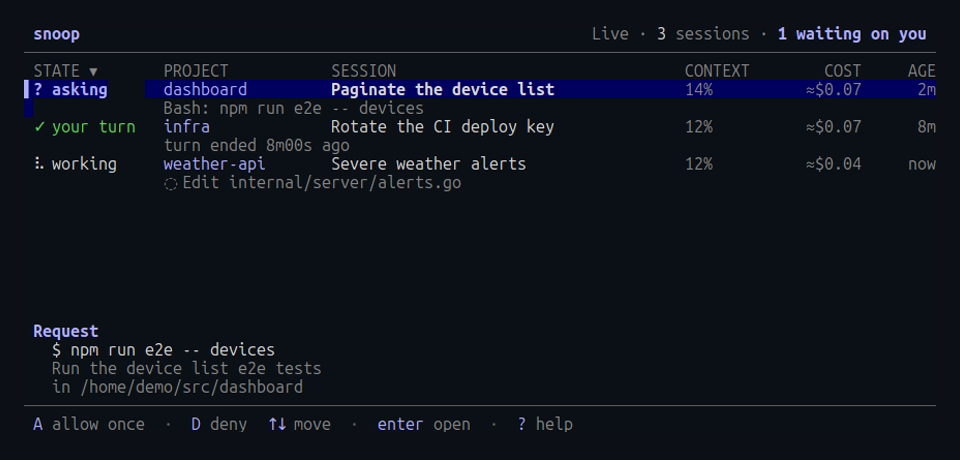
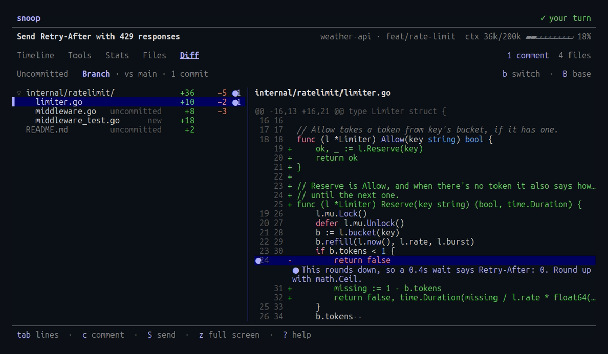

<div align="center">
  <picture>
    <source media="(prefers-color-scheme: dark)" srcset="https://raw.githubusercontent.com/jzills/snoop/main/site/static/mark-dark.svg">
    
  </picture>
</div>

<div align="center">

# snoop

</div>

<div align="center">

[](https://www.npmjs.com/package/snoop-cli)
[](https://pypi.org/project/snoop-cli/)
[](https://github.com/jzills/snoop/blob/main/LICENSE)
[](https://github.com/jzills/snoop/actions/workflows/ci.yml)

[Documentation](https://jzills.github.io/snoop/docs/) · [Install](https://jzills.github.io/snoop/docs/install/) · [Guides](https://jzills.github.io/snoop/docs/guides/) · [Keys](https://jzills.github.io/snoop/docs/reference/keys/)

</div>

A terminal viewer that keeps an eye on your Claude Code agents.
Watch every running session from one board, answer their permission prompts, comment on their diffs, and see what each prompt cost, without switching terminals.

<p align="center">
  
</p>

## Install

It runs on macOS, Linux and Windows, and every install method delivers the same prebuilt binary.

With [Homebrew](https://brew.sh), on macOS or Linux:

```sh
brew install jzills/tap/snoop
```

Or the install script, which checks the build against the release's checksums and installs it without `sudo`:

```sh
curl -fsSL https://jzills.github.io/snoop/install.sh | sh
```

Or from npm or PyPI, where the package is `snoop-cli` and the command is `snoop`:

```sh
npm install -g snoop-cli
pipx install snoop-cli
```

On Windows, use npm, PyPI or the PowerShell script:

```powershell
irm https://jzills.github.io/snoop/install.ps1 | iex
```

See the [install guide](https://jzills.github.io/snoop/docs/install/) for more.

## Follow a session

Keep it open in a second terminal next to `claude`, and every prompt, reply, thinking block and tool call appears as it happens.
The right pane shows the selected item in full: the command, the diff, the subagent's prompt and result.

```sh
snoop --follow    # the newest session in this directory, live
snoop             # pick any past session
```

Each prompt shows its tokens, estimated cost and duration, and the header shows how full the context window is.
Selecting a prompt shows where its turn's time went, in a waterfall where parallel calls overlap.
Press `x` on an Agent call to expand its subagent's work inline, live while it runs.

See the [following guide](https://jzills.github.io/snoop/docs/guides/following/) for more.

## Watch every agent at once

The live board lists every session at work across your projects, with the ones waiting on you first.

<p align="center">
  
</p>

```sh
snoop --live --notify    # every running session, with desktop notifications
```

When a session asks for permission, the request appears in full under the list.
Press `A` to allow it once, `Y` to always allow it, or `D` to deny it with a reason Claude sees.
When a session's turn ends, press `R` to reply, and the agent carries on as if you'd typed it in its terminal.

See the [live board guide](https://jzills.github.io/snoop/docs/guides/live-board/) for more.

## Review and comment

The Diff tab shows what a session changed, either since the last commit or across its whole branch.
Leave comments on a line, a range or a file, and press `S` to send them all to the agent, which picks them up mid-turn or keeps going after it finished.

<p align="center">
  
</p>

Replies, comments and answers to permission prompts reach the agent through Claude Code hooks, which you add once:

```sh
snoop hooks install
```

See the [review guide](https://jzills.github.io/snoop/docs/guides/review/) for more.

## Cost, files and time

The Stats tab breaks a session down by prompt, tool and model, and the Files tab lists every file it read or changed, each with its history as diffs.
In the session picker, press `s` for totals across sessions and a daily cost chart, or `f` to find sessions by a file they changed, a command they ran or a prompt.

See the [cost and context guide](https://jzills.github.io/snoop/docs/guides/cost-and-context/) for more.

## Alerts

While a session runs, the header flags a failed tool call, a stalled one, a finished turn, a compaction, a nearly full context or a permission request.
With `--notify`, the same alerts arrive as desktop notifications through your terminal or the system, over SSH and in WSL too.
With `--cost-alert 5` and `--long-turn 15m`, a runaway session gets flagged as well.

See the [alerts reference](https://jzills.github.io/snoop/docs/reference/alerts/) for more.

## Copy and export

Press `y` to copy the selected command, diff or message, over SSH too, or `e` to export the timeline to Markdown.
From the shell, `snoop export <session>` writes the whole session to stdout.

See the [export guide](https://jzills.github.io/snoop/docs/guides/export/) for more.

## Notes

- It reads the transcripts Claude Code already writes and sends nothing anywhere.
  The only change it makes to Claude Code's settings is the hooks, which `snoop hooks uninstall` removes.
- The transcript format is undocumented, and testing covers Claude Code 2.1.280 through 2.1.310.
  Unknown records are ignored, so a new version may show less rather than break, and an [issue](https://github.com/jzills/snoop/issues) helps when something goes missing.
- A 75 MB transcript opens in about 150 ms.
- This independent project isn't affiliated with or endorsed by Anthropic.
  Claude and Claude Code are trademarks of Anthropic.

## Contributing

Run `go run ./cmd/probe` to parse every local transcript and report timings.
The demo GIF and the site's screenshots are rendered from fictional sessions by `demo/render.sh` and `demo/shots.sh`, which need [vhs](https://github.com/charmbracelet/vhs).

## License

Released under the [MIT License](https://github.com/jzills/snoop/blob/main/LICENSE).
